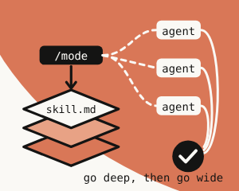
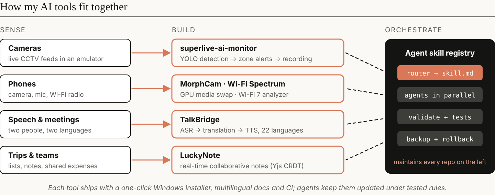
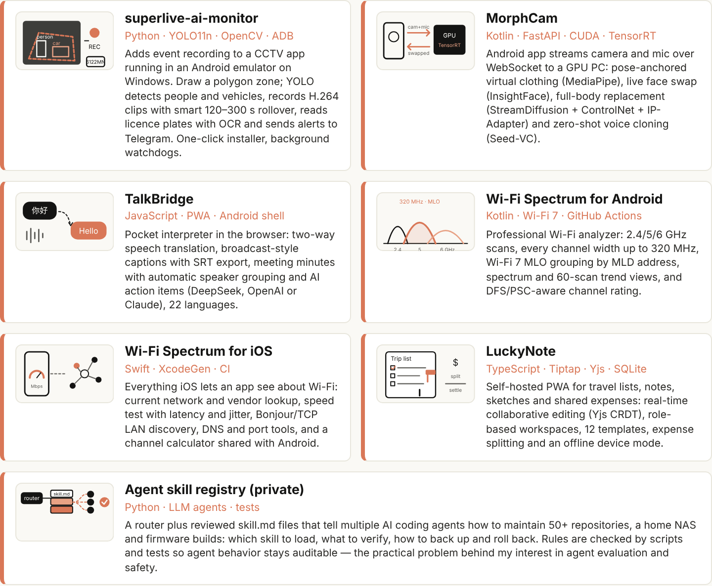

# Hi, I'm Tony Hsu 👋

**Wi-Fi 6/7 firmware lead · builder of AI software** — Hsinchu, Taiwan

- 13+ years in embedded and communications software: Wi-Fi 6/7 access points on Qualcomm IPQ at **Browan Communications**; GPON, Wi-Fi routers and 5G MiFi on Broadcom, Qualcomm, MediaTek and Airoha at **Foxconn (Hon Hai)**.
- After hours I build AI tools end to end — computer vision, real-time speech and media, Wi-Fi analyzers — and run AI coding agents on real hardware under tested rules.
- Interested in **evaluating and constraining tool-using AI agents**.

[LinkedIn](https://www.linkedin.com/in/tony-hsu-a10569136/)

## How my AI tools fit together

## Projects

| Project | What it does | Stack |
|---|---|---|
| [superlive-ai-monitor](https://github.com/tonykfr1234/superlive-ai-monitor) | CCTV event recording: polygon zones, YOLO person/vehicle detection, licence-plate OCR, Telegram alerts | Python · YOLO11n · OpenCV |
| [MorphCam](https://github.com/tonykfr1234/MorphCam) | Android + GPU server: virtual clothing, live face swap, full-body replacement, zero-shot voice cloning | Kotlin · FastAPI · CUDA · TensorRT |
| [TalkBridge](https://github.com/tonykfr1234/TalkBridge) | Pocket interpreter PWA: two-way speech translation, captions, AI meeting minutes, 22 languages | JavaScript · PWA |
| [Wi-Fi Spectrum for Android](https://github.com/tonykfr1234/android_wifi-spectrum) | Wi-Fi 7 analyzer: 2.4/5/6 GHz, up to 320 MHz, MLO grouping, channel rating | Kotlin |
| [Wi-Fi Spectrum for iOS](https://github.com/tonykfr1234/ios_wifi-spectrum) | Speed test, LAN discovery, DNS/port tools, channel calculator | Swift |
| [LuckyNote](https://github.com/tonykfr1234/lucky-note) | Self-hosted collaborative notes and shared expenses (Yjs CRDT) | TypeScript · Tiptap · SQLite |

